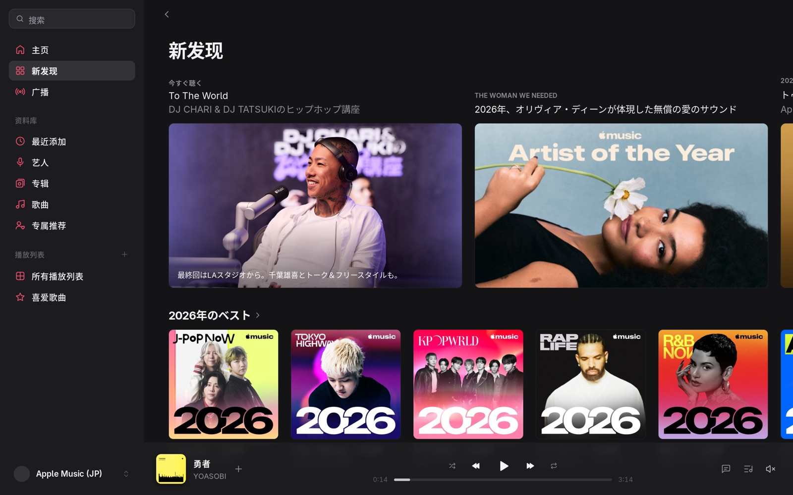
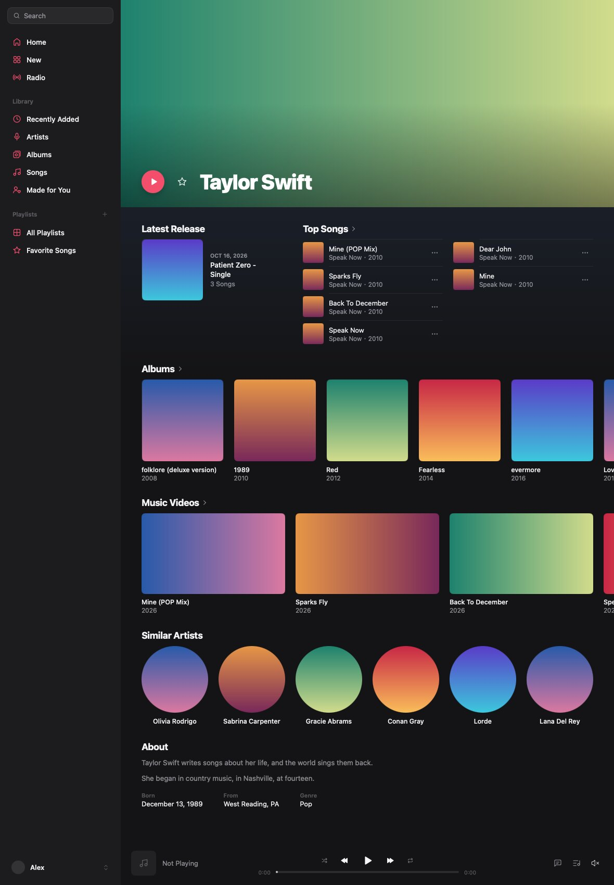
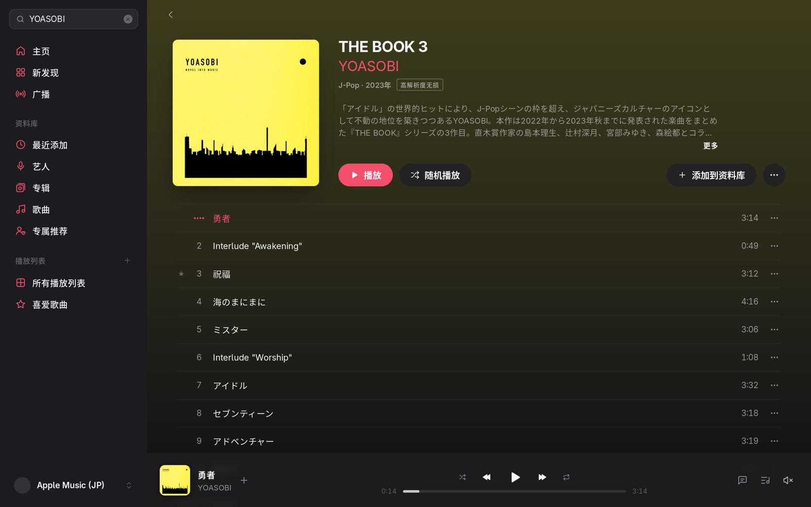
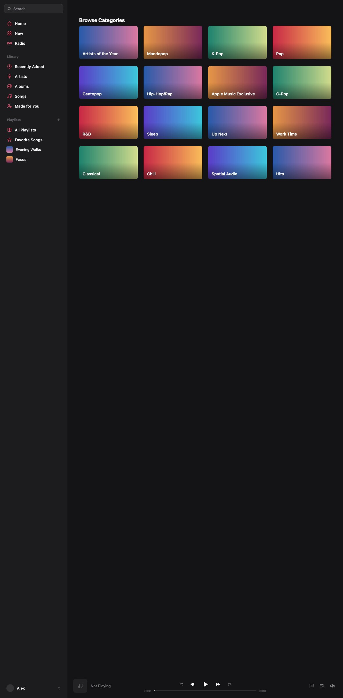

<div align="center">


# Ringo

**A native desktop client for Apple Music**

Written in Go, its windows drawn by [MyGo](https://github.com/egoist/mygo)'s native UI rather than a web page. For macOS, Windows and Linux.

[简体中文](README.md) · **English**

[](https://github.com/LYJW131/ringo/actions/workflows/test.yml)

</div>

> [!IMPORTANT]
> Ringo is a personal project. It has nothing to do with Apple and isn't endorsed by it. It uses the music.apple.com web player's own API, which isn't public and may change at any time; using Apple Music this way likely goes against Apple's terms of service, and an account may be restricted for it. Use only your own account with an active subscription, at your own risk.

## What it does

- **Home, New and Radio** as Apple Music lays them out: heroes, shelves of covers, songs in columns, what's on the air, each section with its See All.
- **Search** opens on Apple Music's categories, and lists top results, artists, albums, songs, playlists, stations and videos on one page.
- **The library** by Recently Added (headed by when things were added), Artists, Albums, Songs, Made for You and All Playlists. Albums and Songs sort by title or by when they were added, keep to favorites, and can be searched; what comes next is fetched ahead, so scrolling doesn't wait. Songs you uploaded to your library play too.
- **Albums, artists and playlists** with the editors' notes, a background in the cover's colors, badges for how an album sounds at its best, the songs most played, and what else to hear. An album names its record label and opens its page, and one the library has only some of offers Show Complete Album. An artist's page is headed, and lists its Top Songs, as Music on the Mac does.
- **Animated Art**: where Apple Music has a cover moving, it plays without sound, over and over, at the head of an album's or a playlist's page, across the top of an artist's, and on Home's tall cards. It can be turned off in the settings, and stays still while the system asks for less motion.
- **Playback** of whole songs as 256 kbps AAC, and with a wrapper, lossless up to 24-bit/192 kHz ALAC, High Efficiency's 64 kbps HE-AAC, and Dolby Atmos songs as their version for headphones (binaural rendering) or for speakers (stereo downmix).
- **Sound Check** evens out how loud songs play, by the loudness Apple measured of each; an album played in order keeps the loudness of the album, and so how its songs stand to one another.
- **Lyrics** that follow the song word by word: the line being sung is sharp and the others soften with distance, a new line comes as a wave down the lines, and light sweeps through each word. A duet's singers take the two sides, backing vocals follow smaller, and dots breathe through an interlude. Translations show where there are any, and lyrics without timing are there to read.
- **Play Next and Play Last**, adding to the library and taking out of it, Favorite (a thing is added to the library before it's a favorite, as in Apple Music), adding to playlists, making and editing playlists, and AutoPlay.
- **What a desktop app has**: media keys, a tray icon, a notch player on macOS, light and dark, session restore, a song cache.
- English and Simplified Chinese, in Apple Music's own words.

Not there yet: playing music videos, Replay, social profiles, concerts.

## Screenshots

| | |
| --- | --- |
|  |  |
|  |  |

The screenshots are drawn by the tests, off screen, with blocks of color for covers and made-up data.

## Download

Get the package for your platform from [Releases](https://github.com/LYJW131/ringo/releases): a `.dmg` for macOS, an installer for Windows, a `.deb` or a `.tar.gz` for Linux. Until there is a release, build it as below.

The macOS app isn't notarized, so the first launch has to be allowed in System Settings › Privacy & Security.

## Signing in

You can sign in to several accounts and switch between them with a click, in the account menu at the foot of the sidebar or in Settings › Account. An account is added in one of two ways:

1. **On Apple's page**: click Sign In at the foot of the sidebar, or Settings › Account › Add Account…, and sign in on Apple's own page. The page can't use a passkey or a security key.
2. **With a media-user-token**: at [music.apple.com](https://music.apple.com), signed in, open the developer tools, copy the value of the `media-user-token` cookie, and paste it in Settings › Account › Add Account… › Use a Media User Token.

With a Wrapper Address filled in, and a wrapper-manager that gives its accounts' tokens (AMDL-Web's does), the accounts ready in it are in the list too, to switch to without adding them. They have no Sign Out: to leave one, switch to another account.

Signed out, you can browse the catalog, search and open pages. Playing, the library and recommendations need an account.

## Lossless, High Efficiency and Dolby Atmos

Lossless, Hi-Res Lossless, High Efficiency and Dolby Atmos play through a [wrapper-manager](https://github.com/AMDL-Web/wrapper/tree/amdl/manager):

1. Run one and log an Apple Music account in to it.
2. Fill in **Wrapper Address** in Settings › Playback, and **Wrapper Key** if the wrapper is behind a gateway that asks for one.
3. Set Streaming to High Efficiency (HE-AAC, 64 kbps), Lossless (up to 24-bit/48 kHz) or Hi-Res Lossless (up to 24-bit/192 kHz) in Settings › Playback.
4. Set Dolby Atmos to Headphones or Speakers: songs with a Dolby Atmos version then play as Apple's rendering of it for headphones (heard in space only through headphones, without head tracking), or as Dolby's mix of it down to stereo. Both are 256 kbps AAC, so those songs no longer play lossless. Ringo plays stereo only, and doesn't decode the 5.1 bed.

Without a wrapper, or where a song has none of what's asked, it plays as 256 kbps AAC. Anyone who can reach the wrapper's port can use the accounts it holds: don't expose one without a key to the internet.

## Building

You need [Go](https://go.dev/dl/) 1.27 or later, and [Bun](https://bun.sh) to evaluate `mygo.config.ts`. There is no cgo, so any machine builds the apps of all three platforms.

```bash
go tool mygo dev
```

```bash
go tool mygo build -platform darwin/arm64,windows/amd64,linux/amd64
```

```bash
go test ./...
```

The apps land in `build/`: a `.app` and a `.dmg` for macOS, an `.exe` and an installer for Windows, an executable, a `.deb` and a `.tar.gz` for Linux.

Every push to `main` and every pull request runs [Test](.github/workflows/test.yml): the format, `go vet`, the build for all six platforms, and every test on Linux and macOS. Pushing a tag that starts with `v` has [Release](.github/workflows/release.yml) build the apps of the three platforms into a draft release, which is published by hand. What a coding agent should know of the project is in [AGENTS.md](AGENTS.md).

## Ringo and the plugin

Ringo's Apple Music code began as a MyGo Music plugin, [mygo-music-apple-music](https://github.com/LYJW131/mygo-music-apple-music). A plugin can only hand its host data through the plugin interface; Ringo is that code ported to Go and built into the app, so it can change the app itself, which is how the layouts, the covers that move, several accounts, the reporting of what plays and the levels of quality came to be. The plugin's README [compares the two](https://github.com/LYJW131/mygo-music-apple-music/blob/main/README.en.md#ringo) feature by feature, and says what a plugin can't do.

## Privacy

- No analytics, no tracking. Ringo talks to Apple's servers and to the wrapper you name, and nothing else.
- The media-user-token is kept in plain text in the app's data folder on this computer and sent only to Apple. Signing out removes this copy only.
- With Use Listening History on, which it is by default, what plays is reported to Apple as its web player reports it: each song's start, pauses, resumes, seeking and end, and the album, playlist or station it plays from, for Recently Played, Replay and recommendations. Quitting waits up to 2 seconds to send the end of the song playing. Turn it off in Settings › General, and nothing is sent.
- Audio is decrypted on this computer. Ringo plays it; it has no way to save a song as a file.

## Credits and license

[AGPL-3.0](LICENSE). What Ringo is built on and ships with, and each one's license, is in [THIRD_PARTY_NOTICES.md](THIRD_PARTY_NOTICES.md).

- The player and the base of the interface come from [MyGo Music](https://github.com/egoist/mygo-music) (AGPL-3.0); the UI framework is [MyGo](https://github.com/egoist/mygo).
- The Apple Music code is a port of [mygo-music-apple-music](https://github.com/LYJW131/mygo-music-apple-music); its lossless part builds on [apple-music-downloader](https://github.com/AMDL-Web/apple-music-downloader), [wrapper](https://github.com/WorldObservationLog/wrapper) and [Temari](https://github.com/WorldObservationLog/Temari).
- Covers that move are decoded by [FFmpeg](https://ffmpeg.org)'s H.264 decoder (LGPL-2.1 or later), built as WebAssembly and run by [wazero](https://wazero.io) (Apache-2.0); `internal/video/wasm/build.sh` rebuilds it from sources at pinned versions.
- High Efficiency's HE-AAC is decoded by FFmpeg's AAC decoder (LGPL-2.1 or later), built as WebAssembly and run by wazero too; `internal/heaac/wasm/build.sh` rebuilds it from sources at pinned versions.
- The brand is described in [brand/README.md](brand/README.md). Ringo's name and mark use none of Apple's trademarks; Apple Music is a trademark of Apple Inc.
