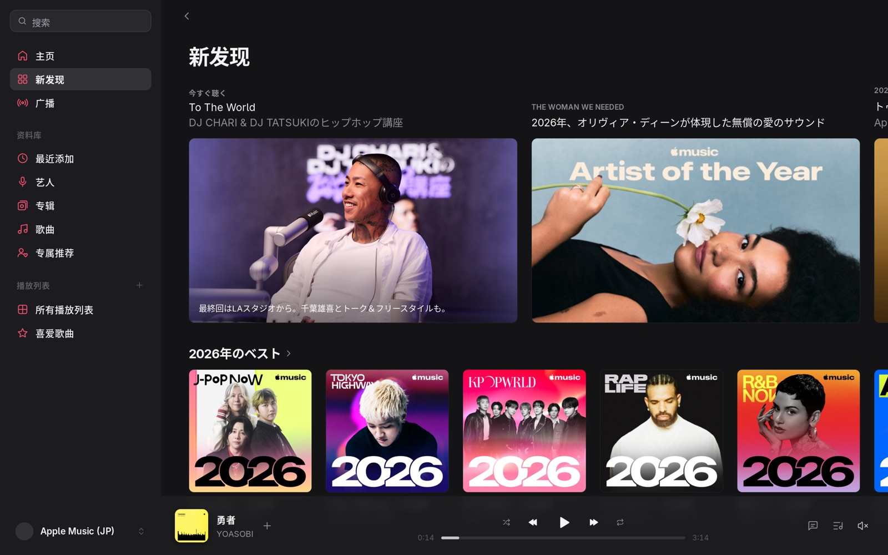
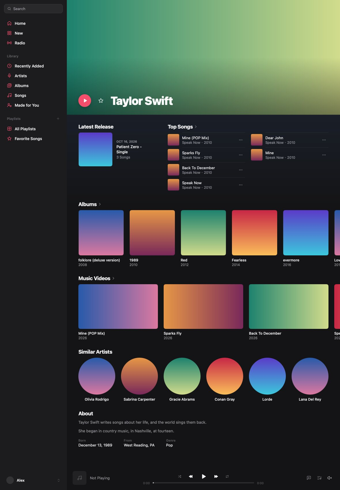
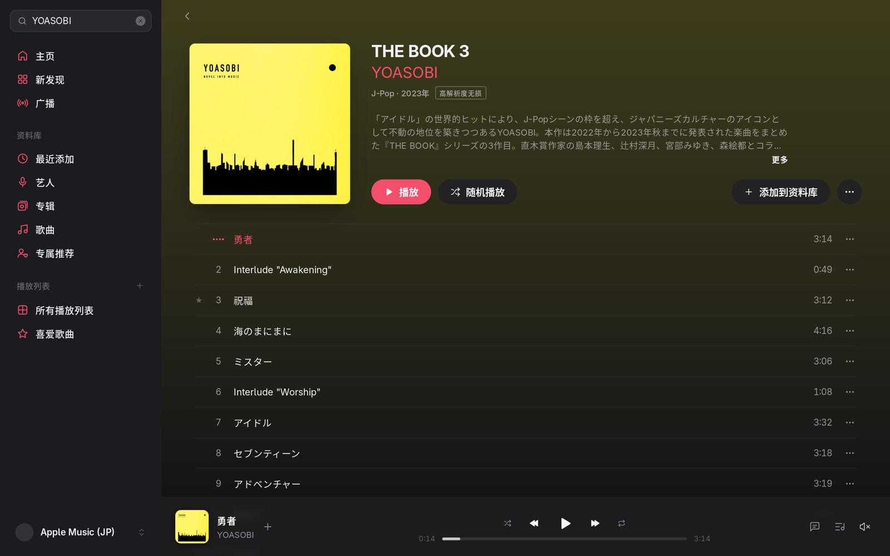
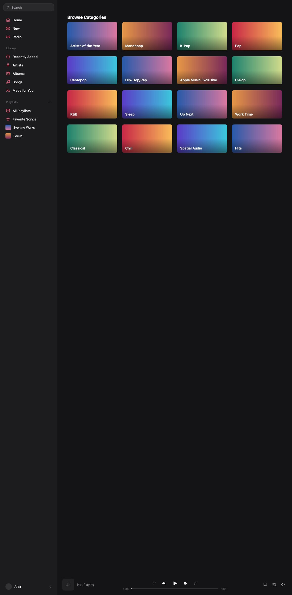

<div align="center">


# Ringo

**Apple Music 的原生桌面客户端**

用 Go 写成，界面由 [MyGo](https://github.com/egoist/mygo) 的原生 UI 绘制，不套网页。macOS、Windows、Linux 三个平台。

**简体中文** · [English](README.en.md)

</div>

> [!IMPORTANT]
> Ringo 是个人项目，与 Apple 没有任何关系，也没有得到它的认可。它使用 music.apple.com 网页播放器自己的接口，不是公开 API，Apple 随时可能更改；这样使用很可能不符合 Apple 的服务条款，账户有被限制的风险。只用你自己的、有有效订阅的账户，后果自负。

## 功能

- **主页、新发现、广播**：按 Apple Music 自己的版式呈现，顶部大图、横向货架、歌曲列、直播电台，每个区块都能「查看全部」。
- **搜索**：未输入时是类别浏览；搜索结果一页列出最佳结果、艺人、专辑、歌曲、播放列表、电台和视频。
- **资料库**：最近添加、艺人、专辑、歌曲、专属推荐、所有播放列表，滚动到底自动加载；你的播放列表在侧栏里。
- **专辑、艺人、播放列表页**：编辑介绍、封面取色的背景、音质标识、热门歌曲标记，以及「其他版本」「更多作品」「类似艺人」等后续内容。
- **播放**：整首 256 kbps AAC；配置 wrapper 后可播放至高 24-bit/192 kHz 的 ALAC 无损。
- **歌词**：逐字跟随，有翻译时一并显示。
- **操作**：插播、最后播放、个人收藏、添加到资料库与移除、添加到歌单、新建和编辑播放列表、自动连播。
- **桌面端该有的**：媒体键、托盘、macOS 刘海播放器、深浅色外观、会话恢复、歌曲缓存、响度均衡。
- 简体中文和英文，用语与 Apple Music 一致。

还没有的：音乐视频的播放、动态封面、Replay、社交资料、演出信息。

## 截图

| | |
| --- | --- |
|  |  |
|  |  |

截图由测试离屏渲染，封面是色块，内容是示例数据。

## 登录

可以登录多个账户，在侧栏底部的账户菜单或「设置 › 账户」里点一下就切换。添加账户有两种方式：

1. **在 Apple 的页面登录**：点侧栏底部的「登录」，或「设置 › 账户 › 添加账户…」，在弹出的 Apple 登录页面里登录。这个页面不支持通行密钥和安全密钥。
2. **Media User Token**：在已登录的 [music.apple.com](https://music.apple.com) 打开开发者工具，从 Cookies 里复制 `media-user-token` 的值，在「设置 › 账户 › 添加账户… › 用 Media User Token」里粘贴并添加。

填了 Wrapper 地址、而 wrapper-manager 能给出账户令牌时（如 AMDL-Web 的版本），它里面已就绪的账户也会列在账户列表里，不用添加就能切换。这些账户没有退出登录，要离开就切到别的账户。

未登录也能浏览目录、搜索和查看页面；播放、资料库和个人推荐需要登录。

## 无损

无损和高解析度无损通过 [wrapper-manager](https://github.com/AMDL-Web/wrapper/tree/amdl/manager) 播放：

1. 部署一个 wrapper-manager 并在其中登录 Apple Music 账户。
2. 在「设置 › 播放」里填 **Wrapper 地址**；wrapper 放在需要密钥的网关后面时，再填 **Wrapper 密钥**。
3. 在「设置 › 播放」里把「流播放」设为「无损」（最高 24 位/48 kHz）或「高解析度无损」（最高 24 位/192 kHz）。

没有 wrapper 或取不到无损音轨时，自动以 AAC 播放。能访问 wrapper 端口的人都能使用其中的账户，不要把没有密钥保护的 wrapper 暴露到公网。

## 构建

需要 [Go](https://go.dev/dl/) 1.27 或更高版本，以及运行 `mygo.config.ts` 用的 [Bun](https://bun.sh)。不需要 cgo，任何一台机器都能编译三个平台的包。

```bash
go tool mygo dev
```

```bash
go tool mygo build -platform darwin/arm64,windows/amd64,linux/amd64
```

```bash
go test ./...
```

产物在 `build/` 下：macOS 是 `.app` 和 `.dmg`，Windows 是 `.exe` 和安装程序，Linux 是可执行文件、`.deb` 和 `.tar.gz`。macOS 的包没有经过 Apple 公证，第一次打开要在「系统设置 › 隐私与安全性」里放行。

## 隐私

- 没有统计和跟踪。Ringo 只连接 Apple 的服务器，以及你自己填的 wrapper。
- media-user-token 以明文保存在本机的应用数据目录里，只发给 Apple；退出登录只删除本机的这一份。
- 「使用收听历史记录」开启时（默认开启），每首歌开始播放时会像 Apple 自己的 App 一样把播放记录发给 Apple，用于「最近播放」、Replay 和推荐。可在「设置 › 通用」里关闭。
- 解密在本机进行；Ringo 只播放，不提供把歌曲另存为文件的功能。

## 致谢与许可证

[AGPL-3.0](LICENSE)。

- 播放器和界面基础来自 [MyGo Music](https://github.com/egoist/mygo-music)（AGPL-3.0），界面框架是 [MyGo](https://github.com/egoist/mygo)。
- Apple Music 部分移植自 [mygo-music-apple-music](https://github.com/LYJW131/mygo-music-apple-music)；无损部分的实现基于 [apple-music-downloader](https://github.com/AMDL-Web/apple-music-downloader)、[wrapper](https://github.com/WorldObservationLog/wrapper) 和 [Temari](https://github.com/WorldObservationLog/Temari)。
- 品牌资产的说明见 [brand/README.md](brand/README.md)。Ringo 的名称与图形不使用 Apple 的商标；Apple Music 是 Apple Inc. 的商标。
